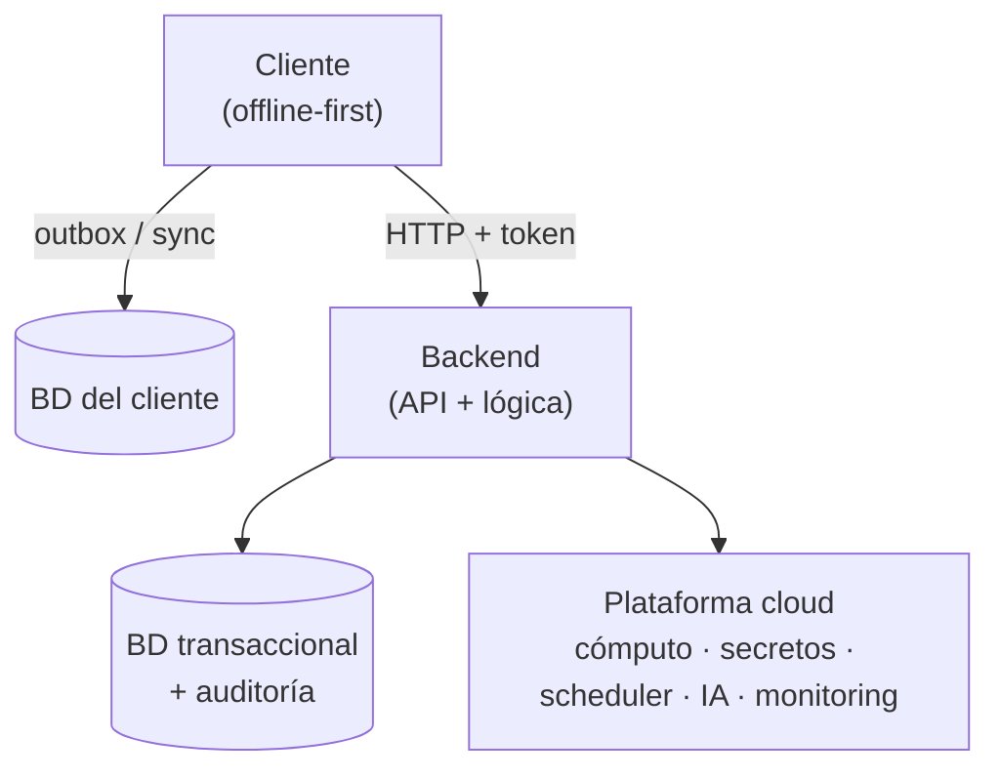

# Master Map — {{PROJECT_NAME}}

> Mapa maestro del proyecto. **No asumir rutas; verificarlas.** Toda doc nueva, renombre o reorg se refleja acá (lo mantiene `docs-dhf`). Versión: v1.7.

## Identidad del dispositivo

| Campo | Valor |
|---|---|
| Producto | {{PROJECT_NAME}} |
| Uso previsto (Intended Use) | {{INTENDED_USE}} |
| Clasificación SaMD | Clase {{SAMD_CLASS}} (IEC 62304 §4.3) |
| Marco regulatorio | IEC 62304 + ISO 14971 + ISO 13485 + GDPR + HIPAA + WCAG 2.1 AA |
| Mapeos cross-framework | EU MDR 2017/745 · FDA (21 CFR 820 + guías) · IMDRF SaMD · ISO/IEC 27001 + SOC 2 (ver [`REGULATORY_FRAMEWORK_CROSSWALK`](../07_regulatory_and_compliance/REGULATORY_FRAMEWORK_CROSSWALK.md)) |
| Stack frontend | {{FRONTEND_STACK}} |
| Stack backend | {{BACKEND_STACK}} |
| Stack datos | {{DB_STACK}} |
| Plataforma cloud | {{CLOUD_STACK}} |

## Arquitectura (alto nivel)

## Índice documental

| Carpeta | Contenido |
|---|---|
| `docs/00_master/` | Master Map, brújula documental. |
| `docs/01_governance_and_strategy/` | Visión, gobernanza, estrategia. |
| `docs/02_architecture_and_design/` | Arquitectura, diseño detallado, diagramas. Incluye [`AGENT_TEAM_AND_FLOW`](../02_architecture_and_design/AGENT_TEAM_AND_FLOW.md) (equipo de 12 agentes por capa + flujo SaMD bajo la Regla 0). |
| `docs/03_software_development_plan/` | Plan de desarrollo IEC 62304, estrategia de testing, guías. |
| `docs/04_user_documentation/` | Guía de usuario (IFU), notas de versión — documentación de cara al usuario. |
| `docs/05_design_decisions/` | RFCs (decisiones estructurales). |
| `docs/06_operations_and_runbooks/` | Runbooks de operación, deploy, incidentes. |
| `docs/07_regulatory_and_compliance/` | Matriz de riesgo ISO 14971, trazabilidad SaMD, validación clínica, IFU, post-market, SBOM, políticas, mapeos cross-framework (FDA / EU MDR / IMDRF / ISO 27001 / SOC 2). |
| `docs/08_verification_and_audits/` | Deuda técnica, historia de deuda, auditorías, reportes de verificación. |
| `docs/09_engineering_experience/` | Lecciones de producción, arquitectura de referencia, método multi-agente (capa de experiencia). |

## Gobernanza del agente (fuera de `docs/`)

El reglamento que gobierna a los agentes vive junto al código, no en el DHF:

| Pieza | Path | Contenido |
|---|---|---|
| Core del reglamento | `CLAUDE.md` | Regla 0, reglas comunes (git, zonas off-limits, diagnóstico, memoria), empatía, boy scout, **arreglar no envolver**, análisis de impacto, cierre de bloque, instrucciones de compactación. Carga en cada turno. |
| Entrada para otras herramientas | `AGENTS.md` | Apunta a `CLAUDE.md` y `.claude/` para las herramientas que leen `AGENTS.md` (Codex y similares); no agrega reglas. |
| Reglas por capa | `.claude/rules/` | Cinco **path-scoped** (backend, UX clínica, testing, CI, documentación) que cargan solas al tocar esa capa + dos transversales (reglas duras de ejecución, comandos) que cargan siempre, también en cada subagente. |
| Estilo de la sesión principal | `.claude/output-styles/orquestador.md` | Preferencias del dueño, orquestación (matriz de agentes, reglas A-F) y sesiones paralelas. Lo activa `outputStyle` en `.claude/settings.json`; solo lo carga la sesión principal (y un fork), no los subagentes. Guardián: `tests/test_estilo_orquestador_enchufado.py`. |
| Equipo de agentes | `.claude/agents/` | 12 especialistas por capa, cada uno con `model:` en el frontmatter (palanca de costo/velocidad — ver el estilo `.claude/output-styles/orquestador.md` §2, que trae también la matriz de "cuándo usar cada uno"). |
| Procedimientos | `.claude/commands/`, `.claude/skills/` | Skills operativas (anti-drift y **tandas de agentes** — cohesión y costo, las dos caras de orquestar—, **ola de auditoría** — veracidad del hallazgo—, **arreglar no envolver** — arreglar en vez de tapar—, cierre de bloque, mutation, diagnóstico, memoria del agente, **reporte corto** — el cierre de una tarea cabe en un celular—). |
| Verificadores y aviso de CI | `scripts/check_doc_{links,anchors,citations}`, `.github/workflows/main-en-rojo.yml` | Tres verificadores de la documentación (enlaces, `#anclas`, citas al código por nombre `ruta/archivo.py::símbolo`; 0 rotas, los corre el CI) y el aviso que abre un Issue cuando un workflow rojea en `main`. Guardianes: `tests/test_citas_del_dhf.py`, `tests/test_workflow_main_en_rojo.py`. |
| Hooks mecánicos | `.claude/settings.json`, `.claude/scripts/` | Candados que no dependen de que el agente se acuerde: `PreToolUse` sobre `Bash` deniega a un SUBAGENTE correr la suite completa o un proceso pesado (`.claude/rules/orquestacion.md`, regla dura 2). |

> Cambios en estas piezas son **cambios de proceso/gobernanza**: se trazan en el
> `SOFTWARE_CONFIGURATION_MANAGEMENT_PLAN` + este Master Map, no en la matriz de riesgo
> (ver `CLAUDE.md` §CIERRE DE BLOQUE GRANDE).

## Dependencias de terceros (SOUP)

| Pieza | Path | Contenido |
|---|---|---|
| Vigilancia | `.github/dependabot.yml` | `npm` (`frontend/`), `pip` (raíz) y `github-actions`; `cooldown` de 14 días; excepciones con motivo y grupo `react`. |
| Versiones fijadas | `frontend/package-lock.json`, `requirements*.txt` | Lockfile del frontend (npm 11), pisos/techos del backend y `mutmut==2.5.1` (anclado por `tests/test_mutmut_gate.py`). |
| Runtime | `.github/workflows/`, `docker-compose.yml`, `.devcontainer/` | Un solo major de Node (24) en todos los sitios. |
| Guardián de la cadena de suministro del CI | `tests/test_workflows_pineados_a_sha.py` | Toda acción de `.github/workflows/` pineada a SHA de 40 caracteres, una sola versión por acción. |

> Política completa en el [`SOFTWARE_CONFIGURATION_MANAGEMENT_PLAN` §7.1](../07_regulatory_and_compliance/SOFTWARE_CONFIGURATION_MANAGEMENT_PLAN.md). Es un cambio de **proceso**: se traza ahí y en este mapa, no en la matriz de riesgo.

## Módulos clínicos críticos

> Listá acá los módulos cuyo fallo tiene impacto clínico (motor de riesgo, crisis, scheduler, dispatcher, validador de IA…). Cada uno debe tener fail-safe explícito + entrada en la Risk Matrix + cobertura de tests verificada.

| Módulo | Path | Riesgo asociado | Control |
|---|---|---|---|
| <ejemplo> | `app/services/<...>` | R-XXX-NN | <fail-safe> |

## Registro de versiones de docs

| Doc | Versión | Última actualización |
|---|---|---|
| MASTER_MAP | v1.7 | 2026-11-07 |
| SOFTWARE_CONFIGURATION_MANAGEMENT_PLAN | v1.9 | 2026-11-07 |
| ISO_14971_RISK_MATRIX | v1.1 | 2026-11-07 |
| TRACEABILITY_MATRIX_SAMD | v1.1 | 2026-11-07 |
